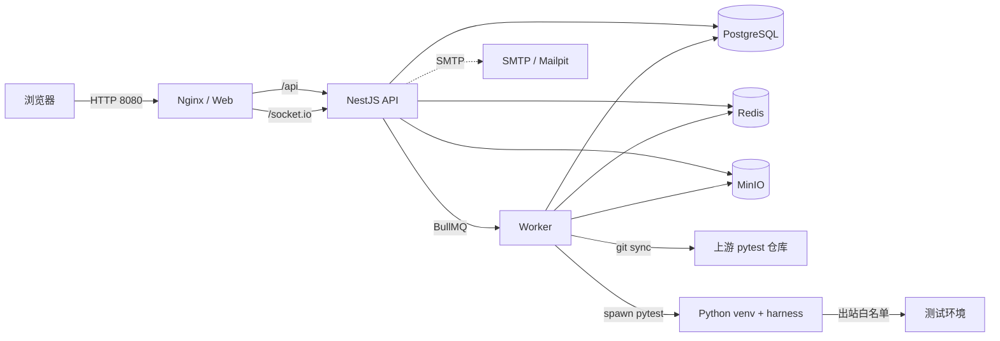

# TestHub

面向团队的测试资产与接口测试平台：用思维导图组织用例库，导入导出 XMind，协作维护测试资产；同时从上游 pytest 仓库同步接口用例，在后台执行并产出具象到请求/响应的测试报告。

TestHub 由两条独立的能力线组成，生命周期互不绑定：

- **测试资产**：工作区、首页概览、多级文件夹、思维导图用例库、XMind 导入导出、单编辑锁协作、角色与审批、审计。
- **接口测试**：同步上游 pytest 用例，按套件/用例/测试集合执行，支持失败重跑、取消、cron 定时与报告查看。

> 产品名是 **TestHub**；仓库、镜像、Compose 服务名仍沿用 `share-mind-map`，两者指同一个系统。

## 核心功能

| 模块       | 能做什么                                                                                                                      | 关键约束                                                                                        |
| ---------- | ----------------------------------------------------------------------------------------------------------------------------- | ----------------------------------------------------------------------------------------------- |
| 身份与成员 | 管理员预创建账号、一次性临时密码、首次登录强制改密、禁用/恢复、重置密码、撤销全部会话；三级角色、编辑权限申请与审批、即时撤销 | 不开放注册；Argon2id；同一账号连续失败 5 次锁定 15 分钟；权限只在服务端校验                     |
| 工作区     | 首页统计、最近文档、公告/待办；用例库浏览、多级文件夹、同级拖拽排序、跨文件夹移动、整棵子树删除、文档管理                     | 单工作空间最多 500 个文件夹、单文件夹 1,000 个文档；最多 8 层；同一父级不允许重名；删除不可恢复 |
| XMind 导入 | 多文件/整目录拖入，按源目录自动归档，逐项改名、选择目标文件夹、取消与重试                                                     | 单批 100 个文件、单文件 20 MB、单文件 20,000 节点、解析超时 5 分钟；解析在 Worker 中执行        |
| XMind 导出 | 从列表或编辑器导出 `.xmind`，保留支持的样式、备注、标签、图标、关系线与图片                                                   | 导出最近一次已保存快照                                                                          |
| 查看与编辑 | `mind-elixir` 画布，增删改节点、撤销/重做、展开收起、缩放适配、图片；编辑锁、心跳续租、串行保存、实时广播已提交快照           | 桌面端 Editor/Admin 单编辑者；Reader 与移动端只读；单图 5 MiB；锁默认 15 分钟                   |
| 接口测试   | 同步上游 pytest 仓库、按套件/用例/测试集合执行、失败单条重跑、取消、cron 定时、报告与可复制 curl                              | 仅 Admin；Worker 单并发；出站域名白名单；结果表当前无清理任务                                   |
| 通知与审计 | 编辑权限申请/审批等站内通知、未读与全部已读；管理员查询审计日志、用量与导入失败记录                                           | 通知面向已登录成员；审计仅 Admin                                                                |

## 使用角色

| 角色   | 能力                                                                   |
| ------ | ---------------------------------------------------------------------- |
| Reader | 浏览工作区与用例库、查看和导出文档、提交编辑权限申请、处理站内通知     |
| Editor | 在 Reader 基础上创建/编辑文档、管理文件夹、发起 XMind 导入、获取编辑锁 |
| Admin  | 成员与权限管理、审批/撤销编辑权限、审计、用量与导入失败记录、接口测试  |

接口测试是 Admin 专属能力：用例代码可以发起任意出站请求并写入测试环境，因此不向 Editor/Reader 开放。

## 接口测试

接口测试不是“在 TestHub 里再写一套用例”，而是执行上游 pytest 仓库并把结果结构化呈现。**上游 `kitarkitar/api-test` 是接口用例的唯一真源**；本仓库的 `api-tests/` 只保留 harness 与依赖清单，不存放用例。

### 使用流程

1. Admin 在「接口测试」页触发同步，Worker 把上游仓库拉到 `api-test-repo` 命名卷。
2. `testcases/` 下的一级目录成为套件；文件和函数由 `collect_cases.py` 静态扫描编目成用例。
3. 选择套件/用例或测试集合，指定环境后发起执行。
4. Worker 单并发 `spawn` pytest，通过 fd3 读取 NDJSON 事件，增量写入每条用例结果。
5. 前端每秒轮询运行状态；报告展示状态、耗时、失败堆栈、请求/响应摘要与可复制 curl，敏感头已脱敏。
6. 失败项可逐条重跑；也可创建 5 段 cron 定时任务，按计划执行套件或集合。

### 测试集合与定时任务

- **测试集合**是有名字的套件/文件/函数组合，保留成员顺序；一次执行形成一个 batch。
- **定时任务**以数据库 `api_test_schedules` 为真源，BullMQ Job Scheduler 只是 Redis 副本，Worker 启动时按库重建。
- cron 为 5 段表达式，默认时区 `Asia/Shanghai`；可配置“执行前先同步”，手动“立即执行”不经过 cron。
- 目标套件/集合消失或环境失效属于永久错误，任务会被停用并记录 `last_error`，避免每轮重复失败。

### 环境、凭据与安全边界

- 内置 `api`、`ydq`、`cjy`、`lw`、`lfx` 五个环境，分别指向对应的 `*.kitarx.com` 测试域名。
- 测试账号只放在 Worker 环境变量中，不入库、不加密；前端只显示“账号已配置”，不回传手机号、验证码或 token。
- pytest 子进程只接收白名单环境变量，不会拿到 `DATABASE_URL`、`REDIS_URL`、`MINIO_*`、`SESSION_SECRET`。
- 出站请求受域名白名单与私网地址拦截约束，且 `allow_redirects=False`。
- 会写测试环境的套件必须显式传 `allow_destructive=true` 并二次确认，默认按只读执行。
- 失败用例保存完整响应，成功用例只保存状态码与耗时；请求体截断到 8 KiB、响应体截断到 256 KiB。

### 已知限制

- 仅 Admin 可见可执行；单次请求最多选择 200 个套件/用例；Worker 单并发。
- 无失败自动告警、无跨轮次趋势图；结果没有清理任务，历史数据会持续增长。
- 不支持在线编辑 Python 用例或动态安装依赖；上游 `requirements.txt` 变化后必须重建 Worker 镜像。
- 生产机出网、上游仓库可达、Git token 有效是硬依赖。
- 接口测试与 XMind 文档互不关联，两者生命周期独立。

执行链路、同步细节、运维命令与完整限制见[项目交接文档 §10](docs/06-项目交接文档.md#10-接口测试模块专题)。

## 技术栈

| 层         | 选型                                                                                      |
| ---------- | ----------------------------------------------------------------------------------------- |
| 前端       | Vue 3、TypeScript、Vite、Element Plus、Pinia、Vue Router、`mind-elixir`                   |
| 后端       | NestJS 11、Express 5、Socket.IO、BullMQ、PostgreSQL 17 + Drizzle、Redis 7、MinIO          |
| 接口测试   | pytest、Python venv、自研 harness、上游 Git 仓库、BullMQ 单并发 Worker                    |
| 契约       | REST + OpenAPI 3.0，`@hey-api/openapi-ts` 生成 TypeScript Client，`pnpm api:check` 防漂移 |
| 测试与工程 | pnpm workspace、Vitest、Playwright、pytest、ESLint、Prettier、Docker Compose              |

画布选型依据见 [ADR 0001](docs/adr/0001-canvas-component.md)。

## 系统架构



- **统一文档模型**：`packages/document-model` 的 `CloudDocumentV1` 是画布、导入、导出与存储共用的唯一结构。
- **异步导入**：API 预检并流式上传到 MinIO `tmp/`，经 BullMQ 投递 Worker；Worker 安全解压、解析、转换并持久化快照与兼容性报告。
- **编辑一致性**：Redis 编辑锁与代次，API 在事务内校验基准版本，提交成功后才广播快照；前端保存队列保证串行。
- **契约驱动**：Swagger 输出 `packages/api-client/openapi.json` 并生成 Client，`pnpm api:check` 做字节级防漂移。
- **接口测试**：API 只做校验与入队，Worker 负责同步、执行、取消、超时和结果落库；报告由前端轮询获取。

模块与依赖方向见[交接文档 §4](docs/06-项目交接文档.md#4-代码地图)，完整 REST 端点见 `packages/api-client/openapi.json`。

## 快速开始

环境要求：Node.js 24.x（`engines` 为 `>=24 <25`）、corepack 与 pnpm 11.5.0、Docker Engine + Compose v2，且能访问 Docker Hub 与 `cgr.dev`。浏览器测试另需 Playwright Chromium。

```bash
corepack enable
corepack prepare pnpm@11.5.0 --activate
pnpm install --frozen-lockfile
pnpm exec playwright install chromium
install -m 600 .env.example .env

docker compose --env-file .env build web api worker
docker compose --env-file .env up -d
pnpm compose:health
```

`.env.example` 只含占位值，可直接用于本地验收；日常开发复制为不提交 Git 的 `.env` 并替换密钥。生产要求 HTTPS、`COOKIE_SECURE=true`、非占位强密钥，并按真实代理层级设置 `TRUST_PROXY_COUNT`。`WEB_ORIGIN` 是唯一允许的 CORS Origin。

访问 `http://127.0.0.1:8080`；API 与 Worker 的就绪检查分别是 `:3000/health/ready`、`:3001/health/ready`，其余依赖端口只绑回环地址，完整端口表见[交接文档 §3.2](docs/06-项目交接文档.md#32-进程与端口)。

首次启动后交互式创建管理员（临时密码只显示一次，首次登录强制改密）；恢复已有 Admin 用 `recover-admin.js`：

```bash
docker compose --env-file .env exec api node dist/cli/init-admin.js
docker compose --env-file .env exec api node dist/cli/recover-admin.js
```

停止用 `docker compose --env-file .env stop`（保留容器与数据）或 `down`（移除容器与网络，保留命名卷）。不要用 `down -v`，除非明确要删除本地持久数据。

### 使用速览

- 用例库支持新建文件夹/空白文档、重命名、移动、拖拽排序和删除；删除文件夹会连同整棵子树永久删除。
- 导入可选中或拖入多个 `.xmind` 与目录，后台 Worker 解析；弹窗用 Socket.IO 展示进度，断线用 REST 回补。
- 文档页在 `/workspace/documents/:documentId`；保存串行提交并校验基准版本，冲突或断网会停止写入并保留本机草稿。
- 接口测试在 Admin 登录后的「接口测试」页；同步上游仓库后即可选择套件/用例/集合执行并查看报告。

## 开发与测试

```bash
pnpm lint
pnpm typecheck
pnpm test:unit
pnpm build
pnpm api:check
pnpm test:compose-structure
```

`pnpm check` 还会跑 `format:check`，但 HEAD 本身已有格式差异，不能作为门禁。`test:unit` 覆盖 workspace 脚本、Compose 结构与各包单元测试。

浏览器验收需要已启动的 Compose 栈与 Playwright：

```bash
pnpm exec playwright test tests/e2e --project=chromium
pnpm exec playwright test tests/e2e/responsive.spec.ts --project=mobile-chrome
```

只起依赖在宿主机跑 API/Worker/前端，以及契约生成、XMind 样本、画布基准等命令，见[交接文档 §7–§8](docs/06-项目交接文档.md#7-本地开发)和 [CLAUDE.md](CLAUDE.md)。

排障先跑 `pnpm compose:health` 和 `docker compose --env-file .env logs --no-color api worker web`；`/health/live` 只证明进程存活，`/health/ready` 才检查依赖。接口测试另需检查 Worker 日志、`api-test-repo` 卷与上游仓库可达性。完整排障手册见[交接文档 §13](docs/06-项目交接文档.md#13-排障手册)。

## 部署

生产目标是 arm64 服务器（`https://testhub.kitarx.com`，ALB 终止 TLS），开发机是 amd64，两个平台使用互不覆盖的镜像标签：`:latest` 为本机 amd64，`:arm64` 为生产镜像。在开发机打包：

```bash
# 构建 arm64、校验架构、临时 retag、打包、恢复 :latest
deploy/make-arm64-bundle.sh --only web

# 已构建过 :arm64，只重新打包（复用现有镜像，不会纳入新代码）
deploy/make-arm64-bundle.sh --only web --skip-build
```

产物 `dist-deploy/share-mind-map-update.tar.gz` 传到目标机，解压到原部署目录（`--strip-components=1 -C ~/share-mind-map-deploy`）后执行 `./deploy.sh`；首次安装才传 `--public-url`。改了接口测试 harness 或依赖时必须重建 Worker。完整步骤、arm64 注意事项与首次安装见 [deploy/README.md](deploy/README.md)。

## 范围与限制

- 历史版本、全局搜索、回收站、分享链接、评论和完整后台状态页尚未实现；文档与文件夹删除不可恢复。
- XMind 兼容性结论基于合成样本，尚未用真实业务文档做 Pilot；上限为单文件 20 MB / 20,000 节点。
- MinIO 为单节点本地卷，Redis 无高可用；本地 Compose 不是生产编排方案，生产还需 TLS、备份、监控告警与容量规划。当前生产环境仍使用 `APP_ENV=development`、`COOKIE_SECURE=false`，安全加固尚未完成。
- 浏览器证据来自 Playwright Chromium，真实 Chrome/Edge 多版本矩阵尚未完成。
- 接口测试仅 Admin、Worker 单并发；结果表没有清理任务会持续增长，无失败告警和跨轮次趋势，并依赖生产机出网与上游仓库可用。

## 文档导航

| 文档                                                                   | 内容                                           |
| ---------------------------------------------------------------------- | ---------------------------------------------- |
| [docs/06-项目交接文档.md](docs/06-项目交接文档.md)                     | 现状、代码地图、核心机制、本地开发、部署与排障 |
| [docs/05-接口测试模块设计.md](docs/05-接口测试模块设计.md)             | 接口测试 P0 历史摘要（决策与已推翻设计）       |
| [docs/07-ARM开发机打包部署.md](docs/07-ARM开发机打包部署.md)           | arm64 打包与部署细节                           |
| [docs/adr/0001-canvas-component.md](docs/adr/0001-canvas-component.md) | 画布组件选型与基准证据                         |
| [docs/benchmarks/canvas/](docs/benchmarks/canvas/)                     | 画布性能与许可证原始结果                       |
| [deploy/README.md](deploy/README.md)                                   | 离线打包、部署、更新与 arm64 标签约定          |
| [CLAUDE.md](CLAUDE.md)                                                 | 本机环境、验证命令与部署操作手册               |
