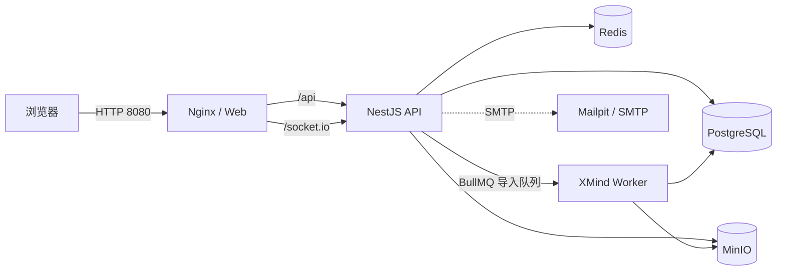

# Shared Mind Map

面向团队内部的共享思维导图平台：在浏览器里浏览用例库、导入和导出 XMind、以单编辑锁协作编辑思维导图，并由管理员维护成员与权限。

项目已完成阶段 0–4（技术验证、平台基础、工作台与权限、XMind 导入导出、正式编辑与实时同步），阶段 5 已交付多级文件夹与首页概览。历史版本、全局搜索、回收站、分享链接、评论和测试执行管理尚未实现，范围见[分阶段开发计划](docs/04-分阶段开发计划.md)。

## 核心功能

| 模块       | 能力                                                                                               | 关键约束                                                                   |
| ---------- | -------------------------------------------------------------------------------------------------- | -------------------------------------------------------------------------- |
| 身份与成员 | 管理员预创建账号、一次性临时密码、首次登录强制改密、禁用/恢复、重置密码、撤销全部会话              | 不开放注册；Argon2id；同一账号连续失败 5 次锁定 15 分钟                    |
| 工作区     | 首页统计、最近文档、待办与公告；用例库浏览、文件夹与文档管理                                       | 单个工作空间最多 500 个文件夹、单文件夹最多 1,000 个文档                   |
| 文件夹     | 多级文件夹、重命名、同级拖拽排序、拖进其他文件夹、整棵子树删除                                     | 最多 8 层（根为第 1 层）；同一父级下不允许重名；删除不可恢复               |
| XMind 导入 | 一次选择或拖入多个文件/整个文件夹，按源目录自动归档，逐项修改目标名称与文件夹，取消与重试          | 单批最多 100 个文件、单文件 20 MB、单文件最多 20,000 节点、解析超时 5 分钟 |
| XMind 导出 | 从文档列表或编辑器导出 `.xmind`，保留支持的样式、备注、标签、图标、关系线与图片                    | 导出最近一次已保存快照，不包含未保存画布状态                               |
| 查看与编辑 | `mind-elixir` 画布、增删改节点、撤销/重做、展开收起、缩放适配、PNG/JPEG/WebP 图片                  | 桌面端 Editor/Admin 单编辑锁；Reader 与移动端只读；单张图片 5 MiB          |
| 协作一致性 | Redis 编辑锁、心跳续租、串行保存、基准版本校验、本机草稿、Socket.IO 已提交快照广播                 | 锁默认 15 分钟过期；版本冲突或断网立即停止写入并保留草稿                   |
| 权限与审计 | Reader/Editor/Admin 三级角色、编辑权限申请与审批、即时撤销、平台通知、审计查询、用量与导入失败记录 | 权限在服务端校验，前端隐藏控件不作为安全边界                               |

## 技术栈

| 层级 | 选型                                                                                           |
| ---- | ---------------------------------------------------------------------------------------------- |
| 前端 | Vue 3、TypeScript、Vite、Element Plus、Pinia、Vue Router                                       |
| 画布 | `mind-elixir`（ADR 见 [docs/adr/0001-canvas-component.md](docs/adr/0001-canvas-component.md)） |
| 后端 | NestJS 11、Express 5、Socket.IO、BullMQ                                                        |
| 数据 | PostgreSQL 17、Drizzle ORM、Redis 7、MinIO                                                     |
| 契约 | REST + OpenAPI，`@hey-api/openapi-ts` 生成 TypeScript Client                                   |
| 工程 | pnpm workspace、Vitest、Playwright、ESLint、Prettier、Docker Compose                           |

## 快速开始

### 环境要求

- Node.js `24.x`（`engines` 要求 `>=24 <25`；镜像内使用 `24.16.0`）
- Corepack 与 pnpm `11.5.0`（根 `packageManager` 已固定）
- Docker Engine 与 Docker Compose v2
- 能访问 Docker Hub 与 `cgr.dev`（MinIO 使用 Chainguard 镜像）
- Chromium 由 Playwright `1.63.0` 管理，仅运行浏览器测试时需要

### 安装与配置

```bash
corepack enable
corepack prepare pnpm@11.5.0 --activate
pnpm install --frozen-lockfile
pnpm exec playwright install chromium

install -m 600 .env.example .env
```

`.env.example` 只含本地测试值与占位值，可直接用于一次性的本地验收。日常运行复制为不提交 Git 的 `.env`，并替换数据库、Redis、MinIO 和会话密钥。生产环境还要求 HTTPS、`COOKIE_SECURE=true`、非占位强密钥，并按真实代理层级设置 `TRUST_PROXY_COUNT`；`APP_ENV=production` 时 API 启动会拒绝本地占位值和 HTTP 公网地址。

`WEB_ORIGIN` 是唯一允许的 CORS Origin；CSRF 令牌由服务端按会话生成并只保存在浏览器内存中，没有静态 CSRF 密钥。

### 启动与访问

```bash
docker compose --env-file .env build web api worker
docker compose --env-file .env up -d
pnpm compose:health
docker compose --env-file .env ps
```

API 容器每次启动都会在 PostgreSQL advisory lock 下幂等执行迁移；MinIO 初始化器创建私有桶并配置生命周期后正常退出。

| 服务          | 地址                                 |
| ------------- | ------------------------------------ |
| Web           | `http://127.0.0.1:8080`              |
| API 就绪      | `http://127.0.0.1:3000/health/ready` |
| Worker 就绪   | `http://127.0.0.1:3001/health/ready` |
| Mailpit       | `http://127.0.0.1:8025`              |
| MinIO Console | `http://127.0.0.1:9001`              |
| PostgreSQL    | `127.0.0.1:15432`                    |
| Redis         | `127.0.0.1:16379`                    |

只有 Web 绑定 `0.0.0.0:8080`，其余端口只绑回环地址。Web 由非 root Nginx 提供静态文件、history fallback、CSP、`/health` 以及 `/api/`、`/socket.io/` 反向代理；API 与 Worker 同样以非 root 用户运行。

### 初始化管理员

系统不提供开放注册。首次启动后执行交互式初始化，命令只显示一次临时密码，首次登录必须改密：

```bash
docker compose --env-file .env exec api node dist/cli/init-admin.js
```

需要恢复现有 Admin 时：

```bash
docker compose --env-file .env exec api node dist/cli/recover-admin.js
```

恢复命令要求交互确认，会重设一次性临时密码、强制改密、撤销该用户全部会话并写入审计记录。密码不能通过 CLI 参数或长期环境变量传入。

### 安全停止

```bash
docker compose --env-file .env stop   # 保留容器与数据
docker compose --env-file .env down   # 移除容器与网络，保留命名卷
```

不要使用 `down -v`，除非明确要删除 PostgreSQL、Redis、MinIO 和 Mailpit 的本地持久数据。

## 使用指南

### 角色与权限

| 角色   | 能力                                                                  |
| ------ | --------------------------------------------------------------------- |
| Reader | 浏览、查看、导出、提交编辑权限申请                                    |
| Editor | 在上述能力上创建/编辑文档、管理文件夹、发起导入、获取编辑锁           |
| Admin  | 在上述能力上管理成员、审批/撤销编辑权限、查看审计、用量与导入失败记录 |

### 工作区与文件夹

登录后进入「首页」查看文档数、节点数、文件夹数、执行中导入与待审批申请，并从「用例库」进入工作台。工作台支持新建文件夹、新建空白文档、重命名、移动、拖拽排序和删除；删除文件夹会连同整棵子树及其文档永久删除，执行前要求确认文档数量。

### 导入与导出

在用例库点击「导入 XMind」，或把 `.xmind` 文件和目录直接拖进导入弹窗：

- 从文件夹树打开弹窗时，本批默认归档到当前选中的文件夹；每行仍可单独修改目标名称和目标文件夹。
- 拖入或选择的目录按相对路径自动创建文件夹；导入根目录与目标文件夹同名时不会重复嵌套。
- 目录名非法、层级超限或创建失败时，该文件退回目标文件夹或未归档，不影响同批其他文件。
- 上传成功后由独立 Worker 解析并持久化，弹窗通过 Socket.IO 展示批次与逐项结果，断线时用 REST 回补；失败任务可取消或重试。

在文档列表或编辑器点击「导出 XMind」读取最近一次已保存快照并生成 `.xmind`。MinIO Bucket 保持私有，`tmp/` 与 `exports/` 对象配置 24 小时生命周期。

### 查看与编辑

文档页在 `/workspace/documents/:documentId`。Reader、移动端、未持锁成员和锁被占用的 Editor/Admin 均为只读；桌面端 Editor/Admin 点击「开始编辑」获取默认 15 分钟锁并持续心跳，结束后释放。

保存按顺序串行提交，服务端校验基准版本；锁失效、版本冲突或网络故障会立即停止写入并保留本机草稿，可复制 JSON 或导出草稿 XMind。Socket.IO 只广播数据库事务成功后的完整快照，旧版本和版本跳跃会被丢弃或触发 REST 回补。

### 管理员操作

「成员管理」创建 Reader/Editor/Admin、一次性重置临时密码、禁用/恢复账号和撤销全部会话；「权限与审计」处理编辑权限申请与即时撤销，查看审计记录、存储用量与导入失败记录。系统拒绝禁用最后一个有效 Admin。

## 系统架构



关键设计：

- **统一文档模型**：`packages/document-model` 定义 `CloudDocumentV1`（Zod Schema 与不变量），画布适配层、导入转换和导出都只读写这一份模型，避免前端、Worker 与数据库各自维护结构。
- **异步导入流水线**：API 预检并流式上传到 MinIO `tmp/`，写入导入任务后投递 BullMQ；Worker 以并发 3 安全解压（条目数、解压大小、压缩比、节点数、超时上限）、解析当前 `content.json` 或旧版 `content.xml`、转换、持久化快照并生成兼容性报告。原文件与 SHA-256 保留，用于查重与排查。
- **编辑一致性**：Redis 保存锁令牌与代次，API 在事务中写入保存请求并校验基准版本，成功提交后才广播快照；前端保存队列保证串行，断线或冲突保留本地草稿。
- **契约驱动前端**：NestJS Swagger 输出 `packages/api-client/openapi.json`，再生成 TypeScript Client；`pnpm api:check` 在临时目录重新生成并做字节级比较，防止契约与客户端漂移。
- **安全边界**：Argon2id 口令、服务端会话、内存 CSRF、登录与上传限流、单一 CORS Origin、CSP 与安全响应头、对象下载鉴权、私有 Bucket、非 root 容器，以及生产配置强校验。

主要 REST 端点（前缀 `/api/v1`）：

| 分组     | 路径                                                                                                 |
| -------- | ---------------------------------------------------------------------------------------------------- |
| 认证     | `auth/login`、`auth/csrf`、`auth/password`、`auth/logout`、`me`                                      |
| 工作区   | `workspaces/:workspaceId/folders`、`documents`、`overview`                                           |
| 导入导出 | `workspaces/:workspaceId/import-batches`、`documents/:documentId/export`                             |
| 编辑     | `documents/:documentId/lock`、`documents/:documentId/snapshots`、`assets`                            |
| 管理     | `admin/members`、`admin/edit-requests`、`admin/audit-logs`、`admin/storage`、`admin/import-failures` |

## 目录结构

```text
share-mind-map/
├── apps/
│   ├── web/                  Vue 3 前端（工作台、文档页、编辑器适配层）
│   ├── api/                  NestJS API、Socket.IO Gateway、CLI 与导入编排
│   └── worker/               BullMQ XMind 导入 Worker
├── packages/
│   ├── database/             Drizzle Schema、仓储、SQL 迁移
│   ├── document-model/       CloudDocumentV1 Schema、不变量与快照工具
│   ├── xmind/                XMind 解析、转换、兼容性检查与导出
│   ├── storage/              MinIO 对象存储封装
│   └── api-client/           OpenAPI 与生成的 TypeScript Client
├── infra/                    Nginx 配置、API/Worker 容器入口脚本
├── deploy/                   离线包与 arm64 打包、目标机部署脚本
├── docs/                     产品、架构、接口、阶段计划、ADR、验收与基准
├── tests/                    跨包测试、Compose 结构测试、Playwright e2e
├── scripts/                  生成、校验、基准与健康检查脚本
├── compose.yaml              本地开发编排
└── pnpm-workspace.yaml       workspace 与依赖构建白名单
```

## 开发与测试

### 本机运行

只启动依赖服务，宿主机运行 API、Worker 和前端 dev server：

```bash
docker compose --env-file .env up -d postgres redis minio minio-init mailpit
set -a; . ./.env; set +a

pnpm --filter @share-mind-map/api... build
pnpm --filter @share-mind-map/database exec node --input-type=module -e 'import {createDatabase,migrateDatabase} from "./dist/index.js"; const db=createDatabase(process.env.DATABASE_URL); try { await migrateDatabase(db); } finally { await db.$client.end(); }'
pnpm --filter @share-mind-map/api start

pnpm --filter @share-mind-map/worker... build
pnpm --filter @share-mind-map/worker start

pnpm --filter @share-mind-map/web dev
```

前端 dev server 使用 `http://127.0.0.1:5173`，需先把 `.env` 的 `WEB_ORIGIN` 临时改为该地址。宿主机进程使用 `DATABASE_URL`、`REDIS_URL`、`MINIO_ENDPOINT` 等本地地址；Compose 容器使用对应的 `COMPOSE_*` 服务名 URL，不能写 `localhost`。宿主机运行 Worker 时要把 `XMIND_FIXTURE_ROOT` 改成仓库内 `tests/fixtures/xmind` 的绝对路径。

### 质量门禁

```bash
pnpm lint
pnpm typecheck
pnpm test:unit
pnpm build
pnpm api:check
pnpm test:compose-structure
```

`pnpm test:unit` 覆盖 workspace 脚本、Compose/验收元数据以及各包单元测试。`pnpm check` 还会执行 `format:check`，但当前 HEAD 已有格式差异，不能作为通过门槛；格式问题只应顺手修复自己改动的文件。

数据库迁移的空库与重复执行验证使用一次性 testcontainers 容器：

```bash
pnpm --filter @share-mind-map/database test:integration
```

`pnpm test:integration` 还会运行 API/Worker 集成测试，它们默认连接 `TEST_DATABASE_URL` 或本机 `localhost:15432` 的开发库。不要在日常开发库上直接运行；需要时显式指定一次性数据库。

浏览器验收依赖已启动的 Compose 栈（`http://127.0.0.1:8080`）与 Playwright Chromium：

```bash
pnpm exec playwright test tests/e2e --project=chromium
pnpm exec playwright test tests/e2e/responsive.spec.ts --project=mobile-chrome
pnpm verify:phase-0-1   # 校验阶段 0–1 验收证据文件是否齐全
```

### 契约、样本与画布证据

```bash
pnpm api:generate        # 由 OpenAPI 重新生成前端 Client
pnpm api:check           # 临时目录重新生成并字节比较

pnpm --filter @share-mind-map/document-model generate:schema
pnpm --filter @share-mind-map/document-model check:schema
pnpm generate:xmind-fixtures
pnpm check:xmind-fixtures
pnpm verify:xmind-worker

pnpm canvas:licenses
pnpm canvas:benchmark
pnpm canvas:adr
pnpm canvas:check
```

XMind 与画布样本均为确定性合成数据，原始基准结果在 `docs/benchmarks/canvas/`。

### 排障

```bash
pnpm compose:health
docker compose --env-file .env ps --all
docker compose --env-file .env logs --no-color api worker web
docker compose --env-file .env logs --no-color postgres redis minio mailpit
```

`/health/live` 只证明进程可响应；`/health/ready` 才验证 API 的 PostgreSQL、Redis、MinIO、SMTP 以及 Worker 的 PostgreSQL、Redis、MinIO、BullMQ 连接。常见排查顺序：

1. 确认 `minio-init` 退出码为 0，长期服务为 `healthy`。
2. 检查容器内 `COMPOSE_*` URL 是否使用 Compose 服务名。
3. 检查宿主机端口冲突与 Docker 可用内存。
4. 只分享脱敏日志，不要分享密码、Cookie、CSRF、会话令牌、文档正文或图片字节。

MinIO 的 Chainguard 镜像以 uid `65532` 运行；若 `minio-data` 卷由旧镜像创建（root 属主），启动会报 `Unable to initialize backend: Unable to write to the backend`：

```bash
sudo chown -R 65532:65532 /var/lib/docker/volumes/share-mind-map_minio-data/_data
```

## 部署

生产目标是 **arm64** 服务器，通过 Docker Compose 运行同一套镜像；开发机是 amd64，因此两个平台使用互不覆盖的镜像标签：

| 标签                              | 内容                | 用途                     |
| --------------------------------- | ------------------- | ------------------------ |
| `share-mind-map-<service>:latest` | 本机 amd64 开发镜像 | 本地 `docker compose up` |
| `share-mind-map-<service>:arm64`  | 生产 arm64 镜像     | 离线包输入，可反复复用   |

```bash
# 构建 arm64、校验架构、临时 retag、打包、恢复 :latest
deploy/make-arm64-bundle.sh --only web

# 已构建过 :arm64，只重新打包（会复用现有镜像）
deploy/make-arm64-bundle.sh --only web --skip-build
```

产物为 `dist-deploy/share-mind-map-update.tar.gz`，传到目标机部署目录后解压并执行 `./deploy.sh`；首次安装才需要显式传 `--public-url`。完整步骤、首次安装、数据迁移、回滚与目标机要求见 [deploy/README.md](deploy/README.md)。

## 范围与限制

- 历史版本、全局搜索、回收站、分享链接、评论、测试执行管理和完整后台系统状态页尚未实现；删除文档与文件夹当前是不可恢复的永久删除。
- XMind 兼容性结论基于合成样本，尚未用真实业务文档和真实图片分布做 Pilot 验收；单文件上限 20 MB、20,000 节点、解析超时 5 分钟。
- MinIO 当前为单节点本地卷，未验证生产对象存储的版本控制、跨区复制与恢复；Redis 保存会话、限流与队列协调状态，未提供高可用或故障切换。
- 本地 Compose 不是生产编排方案；生产需要 TLS 终止、备份恢复、监控告警、容量规划、漏洞扫描与最小权限网络策略。
- 浏览器证据来自 Playwright Chromium，真实 Chrome/Edge 多版本兼容矩阵尚未完成。

## 文档导航

| 文档                                                                   | 内容                                                |
| ---------------------------------------------------------------------- | --------------------------------------------------- |
| [docs/01-产品需求文档.md](docs/01-产品需求文档.md)                     | 角色、功能范围、业务规则与验收标准                  |
| [docs/02-技术架构方案.md](docs/02-技术架构方案.md)                     | 架构原则、模块划分、数据职责、导入/保存/锁/搜索设计 |
| [docs/03-数据库与接口设计.md](docs/03-数据库与接口设计.md)             | 表结构、索引、REST 端点与权限                       |
| [docs/04-分阶段开发计划.md](docs/04-分阶段开发计划.md)                 | 阶段 0–6 交付范围、测试策略与上线检查               |
| [docs/adr/0001-canvas-component.md](docs/adr/0001-canvas-component.md) | 画布组件选型与基准证据                              |
| [docs/verification/](docs/verification/)                               | 各阶段验收记录与截图                                |
| [docs/benchmarks/canvas/](docs/benchmarks/canvas/)                     | 画布性能与许可证原始结果                            |
| [deploy/README.md](deploy/README.md)                                   | 离线打包、部署、更新与 arm64 标签约定               |
| [CLAUDE.md](CLAUDE.md)                                                 | 本机环境、验证命令与部署操作手册                    |
