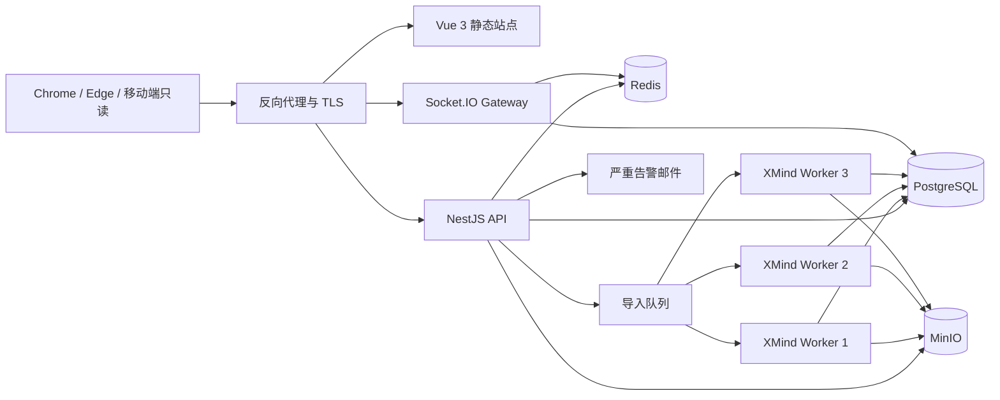
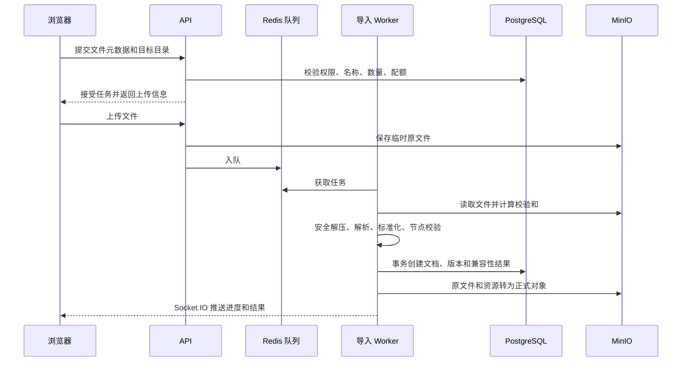
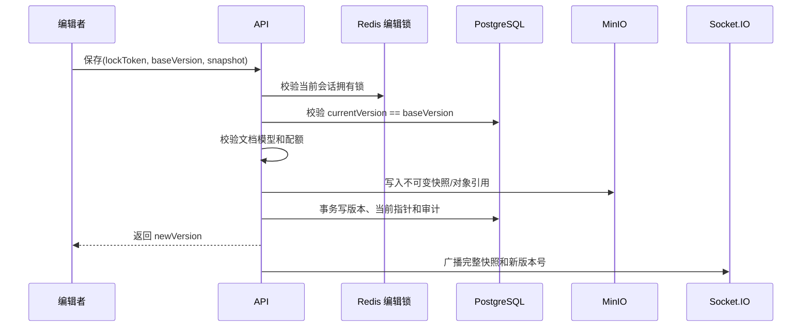

# 共享思维导图平台技术架构方案

版本：V1.1  
状态：首版开发基线  
更新日期：2026-09-16

## 1. 架构原则

- 云端标准文档模型独立于具体 XMind 解析器和画布组件。
- PostgreSQL 与 MinIO 是持久化事实来源；Redis 仅承担会话、协调、缓存和队列职责。
- 首版对单文档串行写入，但接口和版本模型为后续 CRDT/OT 保留扩展位置。
- 可能导致数据丢失的操作必须可确认、可追踪、可恢复。
- XMind 解压、解析和转换必须运行在独立 Worker，不能阻塞 NestJS API 主事件循环。
- 数据库变更采用向前兼容迁移，确保失败时可以优先回滚应用镜像。

## 2. 技术栈

| 层级 | 技术 |
|---|---|
| Web 前端 | Vue 3、TypeScript、Vite |
| UI 组件 | Element Plus |
| 状态管理 | Pinia |
| 路由 | Vue Router、路由元信息、全局导航守卫 |
| 思维导图画布 | 成熟开源组件 + 平台适配层，具体组件由 PoC 决定 |
| 后端 | NestJS、Node.js |
| 接口契约 | REST、OpenAPI、自动生成 TypeScript 类型 |
| 实时通信 | NestJS Socket.IO Gateway |
| 数据库 | PostgreSQL |
| 会话与协调 | Redis |
| 对象存储 | MinIO |
| 部署 | 公司内网服务器、Docker Compose |
| 日志 | 结构化 JSON，按天滚动，保留 30 天，可选接入 ELK/OpenSearch |

## 3. 总体拓扑



首版 API 与 Socket.IO Gateway 可以运行在同一 NestJS 服务中，但模块边界和 Redis 协调机制应允许后续拆分与横向扩展。

## 4. 前端架构

### 4.1 页面模块

- 账号密码登录、首次修改密码和登录失败页。
- 用例库：文件夹/文档列表、排序、搜索、导入、重命名、移动、删除。
- 文档查看/编辑：左侧目录、右侧画布、属性编辑、历史、在线成员、编辑锁、保存和导出。
- 回收站。
- 通知中心。
- 管理后台：成员、审批、审计、存储、导入失败、会话、编辑锁和系统状态。

### 4.2 Pinia 状态边界

- `auth`：当前会话、用户、角色、有效权限。
- `workspace`：文件夹、文档、排序、选择状态和配额。
- `document`：服务端快照、版本、本地脏状态、选中节点和视图状态。
- `editorLock`：锁拥有者、本地锁凭证、心跳和强制释放状态。
- `presence`：在线成员和实时连接状态。
- `import`：批次、任务、进度、结果、取消和重试。
- `notifications`：未读数和通知列表。
- `admin`：审批、审计、存储和系统状态。

前端不得把会话凭证写入 Local Storage。临时未保存内容必须以用户、工作空间和文档为作用域，成功保存或用户明确丢弃后及时清除。

### 4.3 路由与鉴权

- 路由元信息声明登录要求和管理员页面要求。
- 全局导航守卫负责改善页面体验。
- 后端对每个 REST 接口和 Socket.IO 事件执行最终鉴权。
- 权限撤销后立即刷新有效权限、禁用编辑 UI，并先处理未保存内容再退出编辑状态。

### 4.4 画布适配层

内部统一接口示例：

```ts
interface MindMapAdapter {
  mount(container: HTMLElement, snapshot: CloudDocument): void;
  applySnapshot(snapshot: CloudDocument, viewState: ViewState): void;
  exportSnapshot(): CloudDocument;
  focusNode(nodeId: string): void;
  getViewState(): ViewState;
  setReadOnly(value: boolean): void;
  destroy(): void;
}
```

业务 Store、API 和云端模型不得直接依赖第三方组件的节点结构、事件名或序列化格式。

## 5. 后端模块

| 模块 | 职责 |
|---|---|
| Auth | 本地凭证校验、密码修改/重置、会话、登录限流和账号状态 |
| Membership | 工作空间角色、编辑申请、审批、撤销 |
| Folder | 一级文件夹 CRUD、数量和命名约束、回收站转换 |
| Document | 元数据、快照、版本并发、导出编排 |
| Import | 批次、任务、校验、队列、解析、兼容性报告 |
| Asset | 图片校验、对象引用、配额、垃圾回收 |
| Lock | 会话级编辑锁、心跳、过期、强制释放 |
| Realtime | 房间、在线状态、快照广播和重连恢复 |
| History | 版本合并、手动版本、保留和恢复 |
| Search | 名称索引、节点索引、筛选和路径定位 |
| Trash | 软删除、结构恢复、到期和永久删除 |
| Notification | 平台通知、已读状态和保留期 |
| Audit | 不可变关键操作记录和管理员查询 |
| Admin | 用量、失败记录、在线会话、锁和系统状态 |
| Operations | 健康检查、告警、备份元数据和诊断 |

## 6. 数据职责

### 6.1 PostgreSQL

保存组织、工作空间、用户、认证身份与密码哈希、权限、文件夹和文档元数据、当前版本、快照元数据、图片引用、历史、导入任务、通知、审计和告警。用户主体与认证身份分离，便于后续增加 Lark 等身份源而不改变文档作者和权限引用。

### 6.2 MinIO

保存原始 `.xmind`、大型标准文档快照、图片、短期导出文件和备份。开启服务端静态加密和对象校验和，Bucket 不允许公开访问。

### 6.3 Redis

保存服务端会话、用户会话索引、登录失败限流、编辑锁、心跳、在线状态、导入队列、进度和其他限流计数。任何只存在 Redis 的数据都不能成为重建文档的必要事实。

## 7. XMind 导入流程



安全约束：

- 校验扩展名、文件签名、ZIP 条目路径、条目数量、解压总大小和压缩比。
- 阻止目录穿越、解压炸弹、加密压缩包和危险嵌入内容。
- 备注和富文本渲染前清洗；图片按实际字节校验，而非只信任后缀。
- 文档创建以导入任务 ID 保证幂等。
- 失败、取消和定时清理时移除临时对象。

## 8. 保存与版本



即使首版只有单编辑者，仍必须执行乐观版本校验，因为锁过期、管理员强制释放、网络延迟和请求重试都可能产生旧写入。

浏览器需要对自动保存做防抖并串行发送，同一会话不能同时发出多个保存请求。手动保存先冲刷待保存内容并形成明确历史版本。

## 9. 编辑锁与在线状态

- Redis 锁包含文档 ID、用户 ID、平台会话 ID、浏览器编辑会话 ID、锁凭证摘要、锁代次、获取时间和最近心跳。
- 获取、心跳、释放和强制释放使用 Redis 原子操作或 Lua 脚本。
- 心跳间隔必须明显短于 15 分钟过期时间。
- 保存接口同时校验登录会话和不可猜测的锁凭证。
- 强制释放时提升锁代次，使原编辑者的延迟请求失效。
- 在线状态是临时数据，通过 Socket.IO 连接重建。
- 多 Gateway 实例时使用 Redis Socket.IO Adapter。

标准文档信封保留 `schemaVersion`、稳定节点 ID、文档版本和可选因果元数据，为后续 CRDT/OT 扩展准备，但首版不实现操作日志合并。

## 10. 搜索架构

首版优先使用 PostgreSQL：

- 文件夹和文档标准化名称使用 B-tree 索引。
- 节点标题使用全文或 trigram 索引。
- 优先级和标签使用关系字段或 JSONB 索引。
- 保存提交后通过后台任务更新节点索引。

文件夹名和文档名随业务事务立即更新。节点索引任务必须携带文档版本，旧任务不得覆盖新版本索引。权限过滤必须在数据库查询中完成，不能只在前端过滤。

## 11. 安全设计

- 所有 HTTP 和 Socket.IO 流量使用 HTTPS/WSS。
- Redis 服务端会话配合安全 Cookie。
- 密码使用 Argon2id 并按部署环境性能调整参数，数据库只保存哈希结果。
- 不开放用户注册和自助密码找回；临时密码由密码学安全伪随机数生成器生成并仅展示一次，首次登录只允许修改密码或退出。
- 对账号和来源地址同时执行登录限流，登录失败使用统一错误响应，避免账号枚举。
- 密码修改、管理员重置或账号禁用时，通过用户会话索引撤销该用户的所有服务端会话。
- Cookie 鉴权的写接口增加 CSRF 防护。
- 配置严格 CORS 来源白名单和适合画布/图片的 CSP。
- REST、对象下载和 Socket.IO 事件均服务端鉴权。
- 对象使用鉴权流式下载或短期签名 URL，MinIO Bucket 不公开。
- PostgreSQL、MinIO 和备份启用服务端静态加密，密钥由部署环境统一管理。
- 日志不得记录密码、密码哈希、临时密码、Cookie、会话凭证、密钥、图片内容、备注正文或完整文档。
- 首版对登录、导入、图片上传和 WebSocket 建连进行限流。

## 12. 统一错误和追踪

REST 错误结构：

```json
{
  "error": {
    "code": "DOCUMENT_VERSION_CONFLICT",
    "message": "文档已发生变化，请重新加载后处理未保存内容。",
    "details": {},
    "requestId": "01J..."
  }
}
```

- `message` 只包含安全、可执行的用户提示。
- `details` 只提供前端确实需要且可安全展示的结构化信息。
- 堆栈、SQL 错误、对象路径和服务密钥只写服务端日志。
- `requestId` 贯穿 API、Worker、Socket.IO 回执、审计和应用日志。

## 13. 容量与性能设计

- 大目录、树和画布使用虚拟化或分支渐进渲染。
- XMind 解析进程并发固定为 3，并与 API 进程隔离。
- 上传和下载使用流处理，API 不一次性把压缩包及解压内容载入内存。
- 以流式 SHA-256 检查相同内容。
- 在权限和生命周期允许时按校验和复用不可变图片对象。
- 文档、审计、通知和失败记录使用游标分页。
- 缓存只保存可重建内容，并按文档版本失效。
- 压测门槛：普通接口 P95 < 1 秒，搜索/保存 P95 < 2 秒，5,000 节点 3 秒可操作，20,000 节点 5 秒显示首屏并可基本操作。

## 14. Docker Compose 部署

建议服务：

- `reverse-proxy`
- `web`
- `api`
- `worker`
- `postgres`
- `redis`
- `minio`
- 可选 `backup`

PostgreSQL、MinIO 和必要的 Redis 数据使用独立持久化卷，但 Redis 持久化不能替代 PostgreSQL/MinIO 备份。

数据库密码、Cookie 签名密钥等通过服务器环境变量或权限受限的独立 `.env` 注入，不提交 Git。代码库提供仅包含本地测试值或占位值、不包含真实密钥的 `.env.example`，并记录生产环境覆盖和密钥轮换流程。首个管理员由一次性、幂等的交互式初始化命令创建，密码不通过命令行参数或长期环境变量传入。另提供受控、可审计的管理员账号恢复命令，仅在管理员无法登录时由系统维护者执行。

## 15. 发布与回滚

- 系统维护者人工触发固定部署脚本。
- 脚本依次完成配置检查、发布前备份及校验、数据库迁移、镜像更新和健康检查。
- 数据库按“扩展结构 -> 迁移使用 -> 后续版本清理旧结构”演进。
- 发布失败时优先回滚应用镜像，继续使用兼容数据库。
- 只有数据严重损坏且无法修复时才从发布前备份恢复数据库，因为恢复会丢失发布后写入。

## 16. 日志、监控和告警

### 16.1 日志

输出结构化 JSON，至少包含时间、级别、服务、环境、请求 ID、安全的用户/目标 ID、操作、错误码、耗时和结果。按天滚动并保留 30 天，格式保持与后续 ELK/OpenSearch 采集兼容。

### 16.2 健康和状态

提供 API/Worker 存活与就绪检查，并检查 PostgreSQL、Redis、MinIO、导入队列、存储配额和邮件通道。管理员状态页只展示安全的状态和近期故障，不暴露配置与密钥。

### 16.3 告警

- 普通问题产生平台内管理员告警。
- 严重问题额外发送邮件给系统维护者和管理员。
- 首版严重条件至少包括：服务不可用、数据库/对象存储故障、导入持续失败、队列严重积压、存储达到 95% 或 100%。
- 需要告警去重和恢复通知，避免重复轰炸。

## 17. 备份与灾难恢复

- 每日自动备份，保留最近 30 天。
- PostgreSQL 备份必须与 MinIO 对象引用和必要部署元数据保持一致。
- 备份加密并限制恢复权限。
- 每日备份后自动执行完整性校验。
- 每月在隔离环境做一次完整恢复演练。
- 恢复目标：RPO 24 小时、RTO 4 小时。
- 管理员可发起或提出恢复操作，但首版基础设施恢复仍由系统维护者执行受控流程。

## 18. 画布组件 PoC

在正式选定 `simple-mind-map`、MindElixir 或其他组件前，使用同一批样本验证：

- 许可证允许公司内部部署以及计划中的修改和分发方式。
- 可通过适配层集成 Vue 3，不污染平台标准文档模型。
- 5,000 节点在参考设备 3 秒内可操作。
- 20,000 节点可渐进渲染，内存稳定且 5 秒内出现可操作首屏。
- 支持只读、稳定 ID、新增、删除、改层级、排序、折叠、快捷键、缩放、平移、撤销钩子、图片、标签、图标和基础样式。
- 完整快照替换后可以恢复选择、展开和滚动等视图状态。
- 导出的标准模型结果稳定、可重复。
- 不依赖外部云服务。

PoC 必须记录实测结果、许可证结论和已知缺口。没有候选组件通过时，应先收缩首版编辑能力并重新评审，不应直接默认进入高成本全自研。

## 19. 后续扩展点

- 多组织、多工作空间。
- 文件夹/文档级权限。
- CRDT/OT 和多编辑者。
- 多级文件夹。
- 测试执行和报表。
- 开放 API。
- 完整移动端、深色模式、更多浏览器和身份源。
- Kubernetes、多实例 Worker、集中日志和完整指标平台。
