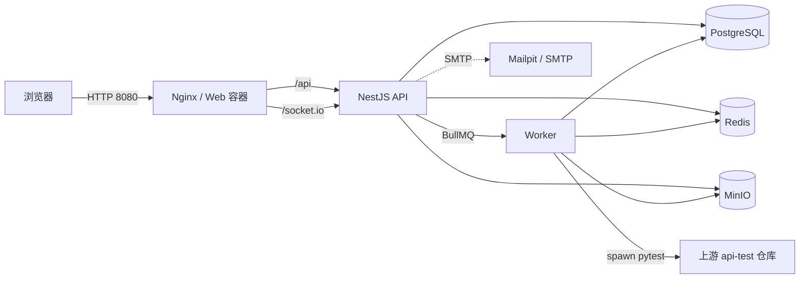

# Share Mind Map / TestHub 项目交接文档

> **读者**：接手本仓库开发、部署和日常运维的人。
> **基线**：`main` 分支 `f243df5`，2026-11-09。文中的生产状态来自 [CLAUDE.md](../CLAUDE.md) 与现有部署脚本，交接当天没有重新登录生产机核验，见第 12 节清单。
> **维护方式**：架构、部署方式、外部依赖或已知问题发生变化时，改动请同步更新本文；不要只更新 README。

---

## 1. 一页纸总结

**它是什么**：一个面向团队内部的共享思维导图平台，对外名称是 **TestHub**。核心能力是：

- 管理员预创建账号，Reader / Editor / Admin 三级权限，不开放注册；
- 多级文件夹 + 思维导图文档的浏览、创建、移动、排序、删除；
- XMind 文件的批量导入（后台 Worker 解析）与导出；
- 基于 Redis 编辑锁 + 版本校验的单编辑者协作编辑，Socket.IO 广播已提交快照；
- **接口测试模块**：从上游 pytest 仓库同步用例，在 Worker 里执行，产出逐条请求/响应报告，支持测试集合和 cron 定时执行。

**当前状态**：

| 项目 | 状态 |
| --- | --- |
| 生产环境 | AWS `ap-southeast-3` EC2，arm64，入口 `https://testhub.kitarx.com`（ALB 终止 TLS） |
| 代码仓库 | `git@github.com:Evan-Hz28/share-mind-map.git` |
| 部署形态 | 单机 Docker Compose，7 个常驻容器 |
| 已完成范围 | 阶段 0–5（技术验证、平台基础、工作台与权限、XMind 导入导出、正式编辑、多级文件夹/首页） |
| 额外模块 | 接口测试（不在原阶段计划内，2026-10 后新增，见第 10 节） |
| 未实现 | 历史版本、全局搜索、回收站、分享链接、评论、完整后台系统状态页；生产备份/监控/HA 尚未落地 |

**接手后建议先做的五件事**：

1. 按第 7 节在本机把 7 个容器跑起来，登录一次。
2. 按第 9 节核对生产机 `docker compose ps` 和 `/health`，确认文档描述与真实环境一致。
3. 读第 11 节的“已知问题与技术债”，特别是文档漂移和未提交改动。
4. 确认第 12 节列出的账号、密钥、域名、上游仓库 token 都已实际交付，而不是只写在文档里。
5. 不要直接跑 `pnpm check`；用第 8 节的命令。

---

## 2. 项目现状

### 2.1 已交付功能

| 模块 | 能做什么 | 关键限制 |
| --- | --- | --- |
| 身份与成员 | 管理员预创建账号、一次性临时密码、首次登录强制改密、禁用/恢复、重置密码、撤销全部会话 | 不开放注册；Argon2id；连续失败 5 次锁 15 分钟 |
| 工作区 | 首页统计、最近文档、公告/待办；用例库浏览、文件夹与文档管理 | 单工作空间最多 500 个文件夹、单文件夹 1,000 个文档 |
| 文件夹 | 多级文件夹、重命名、同级拖拽排序、拖入其他文件夹、整棵子树删除 | 最多 8 层；同一父级不允许重名；删除不可恢复 |
| XMind 导入 | 多文件/整目录拖入，按源目录自动归档，逐项改名和选目标文件夹，取消与重试 | 单批 100 个文件、单文件 20 MB、单文件 20,000 节点、解析超时 5 分钟 |
| XMind 导出 | 从列表或编辑器导出 `.xmind`，保留支持的样式、备注、标签、图标、关系线、图片 | 导出最近一次已保存快照 |
| 查看与编辑 | `mind-elixir` 画布，增删改节点、撤销/重做、展开收起、缩放适配、图片 | 桌面端 Editor/Admin 单编辑锁；Reader 和移动端只读；单图 5 MiB |
| 协作一致性 | Redis 编辑锁、心跳续租、串行保存、基准版本校验、本机草稿、Socket.IO 已提交快照广播 | 锁默认 15 分钟；冲突/断网立即停止写入并保留草稿 |
| 权限与审计 | 三级角色、编辑权限申请与审批、即时撤销、通知、审计查询、用量与导入失败记录 | 权限全部服务端校验 |
| 接口测试 | 同步上游 pytest 用例、按套件/用例执行、测试集合、失败重跑、cron 定时执行、报告与 curl | 仅 Admin；Worker 单并发；出站域名白名单 |

文档基线：`docs/01-04`、`docs/superpowers` 和 `docs/archived` 已删除，`docs/verification` 的阶段验收记录与截图也已移除；旧版 01–04 只在 git 历史（`f243df5` 及更早）中可查。

### 2.2 当前代码与文档的偏差（交接时必须知道）

这些不是“小笔误”，会直接影响接手判断：

1. **[deploy/README.md](../deploy/README.md) 的“路线 B”已过时**。它说 MinIO 的 quay.io 镜像在哪个 registry 都拉不到、目标机是 amd64；实际 `compose.yaml` 已改为 `cgr.dev/chainguard/minio`，生产目标是 arm64。`dist-deploy/minio-images.tar.gz` 是旧的 amd64 quay 镜像，不要再使用。
2. **接口测试的“结果保留 100 轮 / 90 天”没有实现**。`docs/05` 里记录过这个设计，代码里没有清理任务，`api_test_runs` / `api_test_run_items` 会一直增长。
3. **仓库状态**：`main` 比 `origin/main` 多 2 个提交（`5795524`、`3176dee`）；工作区还有未提交的 `docs/05`、`README.md` 修改，以及 `scripts/verify-phase-0-1.mts`、`target.md` 删除。接手后先决定这批改动怎么提交，再开始改代码。
4. **`docs/05` 只保留决策摘要**。V0.3 全文（含插件协议、环境与安全细节）已移到 git `92557f8`；issue 追溯时用 `git show 92557f8:docs/05-接口测试模块设计.md`，不要指望工作区文档还有那些章节。

---

## 3. 系统架构

### 3.1 总览



### 3.2 进程与端口

| 服务 | 容器内端口 | 宿主端口 | 作用 |
| --- | --- | --- | --- |
| web | 8080 | `0.0.0.0:8080` | Nginx 静态资源 + `/api/`、`/socket.io/` 反代 |
| api | 3000 | `127.0.0.1:3000` | REST、Swagger/OpenAPI、Socket.IO、启动时跑迁移 |
| worker | 3001 | `127.0.0.1:3001` | XMind 校验/导入、通知 outbox、接口测试执行/同步/调度 |
| postgres | 5432 | `127.0.0.1:15432` | 业务真源 |
| redis | 6379 | `127.0.0.1:16379` | 会话、限流、编辑锁、BullMQ、调度副本 |
| minio | 9000/9001 | `127.0.0.1:9000/9001` | 私有对象存储 |
| mailpit | 1025/8025 | `127.0.0.1:1025/8025` | 本地 SMTP 捕获 |
| minio-init | — | — | 一次性建桶/设生命周期，退出码应为 0 |

只有 web 对外。生产由 ALB 把 443 转到 8080，EC2 不直接对公网开放 8080。

### 3.3 三条关键数据流

**导入**：API 预检并流式上传到 MinIO `tmp/` → 写 `import_jobs` → 投 BullMQ → Worker 安全解压（条目数、解压大小、压缩比、节点数、超时）→ 解析 `content.json` 或旧版 `content.xml` → 转 `CloudDocumentV1` → 保存快照并生成兼容性报告 → 前端用 Socket.IO 看进度，断线用 REST 回补。

**保存**：前端串行提交 → API 校验编辑锁令牌和基准版本 → PostgreSQL 事务写 `document_save_requests` / `document_snapshots` → 成功后才通过 Socket.IO 广播完整快照 → 旧版本或版本跳跃被丢弃或触发 REST 回补。

**接口测试**：Admin 点同步/执行 → API 写 run 或 sync 记录并投 BullMQ → Worker 拉取上游仓库、或 spawn pytest → 读 fd3 的 NDJSON 事件 → 增量写 `api_test_run_items` → 前端每秒轮询报告。

### 3.4 不能违反的设计约束

- 云端文档模型 `CloudDocumentV1` 不依赖任何第三方画布结构；画布适配层、导入、导出都只读写这一份模型。
- PostgreSQL / MinIO 是持久化事实来源；Redis 不保存唯一业务数据（调度也以数据库表为准，Worker 启动时重建）。
- 所有权限在服务端校验，前端隐藏按钮不是安全边界。
- XMind 解压解析只在独立 Worker 中做，不能阻塞 API。
- 迁移必须能从空库执行，并支持重复执行。
- 敏感值只走环境变量或 600 权限的 `.env`，不写日志、不进 Git。

---

## 4. 代码地图

```text
share-mind-map/
├── apps/
│   ├── web/                  Vue 3 + Vite + Element Plus + Pinia
│   ├── api/                  NestJS 11 + Express 5 + Socket.IO
│   └── worker/               BullMQ 消费者 + 健康检查服务
├── packages/
│   ├── database/             Drizzle Schema、仓储、SQL 迁移
│   ├── document-model/       CloudDocumentV1 Zod Schema、不变量、快照工具
│   ├── xmind/                XMind 解压/解析/转换/导出
│   ├── storage/              MinIO 封装
│   └── api-client/           由 OpenAPI 生成的 TypeScript Client
├── api-tests/                接口测试的 Python harness 与依赖清单（不含用例）
├── infra/                    Nginx、容器入口脚本
├── deploy/                   离线包、arm64 打包、目标机部署脚本
├── tests/                    跨包测试、Compose 结构测试、Playwright e2e
├── scripts/                  生成、校验、基准、健康检查
├── docs/                     设计、ADR、验收、本文档
├── compose.yaml              本地/生产共用编排
└── CLAUDE.md                 本机环境与部署操作手册
```

依赖方向（不要反向）：

```text
web    -> api-client + document-model
api    -> database + document-model + xmind + storage
worker -> database + document-model + xmind + storage
```

### 4.1 入口文件

| 位置 | 作用 |
| --- | --- |
| [apps/api/src/main.ts](../apps/api/src/main.ts) | API 启动、body limit、CORS、全局前缀 `/api/v1`、错误过滤器 |
| [apps/api/src/app.module.ts](../apps/api/src/app.module.ts) | 模块装配；新增业务模块要在这里注册 |
| [apps/api/src/openapi.ts](../apps/api/src/openapi.ts) | Swagger/OpenAPI 输出 |
| [apps/worker/src/main.ts](../apps/worker/src/main.ts) | 所有队列 Worker、健康检查、调度恢复 |
| [apps/worker/src/queue.ts](../apps/worker/src/queue.ts) | 队列名与并发配置 |
| [apps/web/src/main.ts](../apps/web/src/main.ts) | 前端挂载 |
| [apps/web/src/router.ts](../apps/web/src/router.ts) | 路由、登录/改密/管理员守卫 |
| [packages/database/src/migrate.ts](../packages/database/src/migrate.ts) | advisory lock + 幂等迁移 |
| [infra/nginx/default.conf](../infra/nginx/default.conf) | CSP、`/api/`、`/socket.io/` 反代 |
| [infra/docker/api-entrypoint.sh](../infra/docker/api-entrypoint.sh) | 启动前先跑迁移 |

### 4.2 常见改动落点

| 想改什么 | 先看哪里 |
| --- | --- |
| 登录/会话/CSRF/限流 | `apps/api/src/auth/` |
| 角色与越权 | `apps/api/src/common/guards/`、`apps/api/src/membership/` |
| 文件夹/文档 | `apps/api/src/folders/`、`apps/api/src/documents/`、`packages/database/src/repositories/folder.repository.ts` |
| 编辑锁/保存/冲突 | `apps/api/src/locks/`、`apps/api/src/documents/`、`apps/web/src/editor/` |
| 实时广播 | `apps/api/src/realtime/`、`apps/web/src/realtime/` |
| XMind 导入/导出 | `packages/xmind/`、`apps/worker/src/import/`、`apps/api/src/imports/`、`apps/api/src/exports/` |
| 画布行为 | `apps/web/src/editor/adapters/mind-elixir.ts`、`CloudDocumentV1` 模型 |
| 接口测试 | `apps/api/src/api-tests/`、`apps/worker/src/api-test/`、`apps/web/src/api-tests/`、`api-tests/harness/` |
| 数据库表/迁移 | `packages/database/src/schema/`、`packages/database/migrations/` |
| 前端契约类型 | 改 API DTO 后跑 `pnpm api:generate`，不要手改 `packages/api-client/src/generated/` |

### 4.3 契约驱动流程

NestJS DTO/Swagger → `packages/api-client/openapi.json` → `@hey-api/openapi-ts` 生成 TS Client。

```bash
pnpm api:generate   # 重新生成
pnpm api:check      # 临时目录重新生成并字节比较，防漂移
```

改了任何 Controller/DTO 后必须跑 `api:generate`，否则前端类型和运行时不一致。

---

## 5. 核心机制

### 5.1 认证、会话与权限

- 本地账号密码，Argon2id；数据库只存哈希。
- Redis 服务端会话；Cookie HttpOnly，按环境设 Secure/SameSite；前端不持久化会话凭证。
- CSRF 令牌按会话生成、只存浏览器内存，没有静态 CSRF 密钥。
- 登录失败对账号和来源地址分别限流；错误响应不泄露账号是否存在。
- 角色：Reader / Editor / Admin。编辑权限还有单独的“申请—审批—撤销”流程。
- 系统拒绝禁用最后一个有效 Admin。
- 管理员初始化/恢复是交互式 CLI，临时密码只显示一次：
  - `apps/api/src/cli/init-admin.ts`
  - `apps/api/src/cli/recover-admin.ts`
  - 密码不能通过 CLI 参数或长期环境变量传入。

### 5.2 文件夹与文档

- 文件夹树最多 8 层，同一父级不允许重名；删除文件夹会永久删除整棵子树和其中文档，前端要求确认。
- 文档内容以 `CloudDocumentV1` 快照保存；文档列表读取最近一次已保存快照。
- XMind 导出不包含画布未保存状态。

### 5.3 编辑锁与保存

- Redis 保存锁令牌与代次，默认 15 分钟过期；前端心跳续租。
- 只有桌面端 Editor/Admin 能“开始编辑”；Reader、移动端、锁被占用时只读。
- 保存队列串行提交，服务端校验基准版本；锁失效、版本冲突、断网都会立即停止写入并保留本机草稿。
- 只有数据库事务成功后才会广播快照。

### 5.4 XMind 导入导出

- API 做预检和上传，Worker 做解压、解析、转换；原文件和 SHA-256 保留用于查重和排查。
- 安全限制在 `packages/xmind/`：路径穿越、条目数、解压大小、压缩比、节点数、超时。
- MinIO Bucket 私有；`tmp/` 和 `exports/` 有 24 小时生命周期。

### 5.5 接口测试

单独见第 10 节。

---

## 6. 数据模型

### 6.1 表分组

| 分组 | 主要表 |
| --- | --- |
| 身份 | `organizations`、`users`、`auth_identities`、`workspace_memberships` |
| 工作区/文档 | `workspaces`、`folders`、`documents`、`document_snapshots`、`document_save_requests`、`document_assets`、`snapshot_asset_refs` |
| 导入导出 | `import_batches`、`import_jobs`、`export_jobs` |
| 权限/通知/审计 | `edit_permission_requests`、`notifications`、`audit_logs` |
| 接口测试 | `api_test_environments`、`api_test_suites`、`api_test_cases`、`api_test_runs`、`api_test_run_items`、`api_test_collections`、`api_test_collection_items`、`api_test_schedules`、`api_test_syncs` |

接口测试表只有迁移和 `packages/database/src/repositories/api-test.repository.ts`，没有单独的 Drizzle schema 文件，改表时注意这一点。

### 6.2 迁移

- SQL 在 `packages/database/migrations/`，按编号顺序执行；当前到 `0013_api_test_cases.sql`。
- API 容器每次启动都会在 PostgreSQL advisory lock 下幂等执行迁移，不需要单独命令。
- 新增迁移必须能从空库执行，也能在已有库上重复执行（用 `IF NOT EXISTS` / `ON CONFLICT` 等）。
- 不要修改已发布的迁移；新增一个编号文件。

常见迁移操作：

```bash
# 本机跑 API 时会自动迁移；也可以显式跑：
pnpm --filter @share-mind-map/database build
pnpm --filter @share-mind-map/database exec node --input-type=module -e \
  'import {createDatabase,migrateDatabase} from "./dist/index.js"; const db=createDatabase(process.env.DATABASE_URL); try { await migrateDatabase(db); } finally { await db.$client.end(); }'
```

`pnpm --filter @share-mind-map/database test:integration` 用 testcontainers 验证空库迁移和重复执行。

---

## 7. 本地开发

### 7.1 环境

- Node `24.x`（`engines` 要求 `>=24 <25`）
- pnpm `11.5.0`（corepack）
- Docker Engine + Compose v2
- Docker Hub 与 `cgr.dev` 可访问。本机 Docker Hub 被 DNS 污染，已配腾讯云内网加速器；该加速器**不覆盖** `cgr.dev` / `quay.io`。
- Playwright Chromium（`pnpm exec playwright install chromium`），中文截图需要 `fonts-wqy-microhei`。

### 7.2 首次安装

```bash
corepack enable
corepack prepare pnpm@11.5.0 --activate
pnpm install --frozen-lockfile
pnpm exec playwright install chromium
install -m 600 .env.example .env
```

`.env` 不要提交；生产值见 `deploy/.env`（同样保持 600）。

### 7.3 整套跑起来

```bash
docker compose --env-file .env build web api worker
docker compose --env-file .env up -d
docker compose --env-file .env ps
pnpm compose:health
```

首次启动后创建管理员（密码只显示一次，首次登录强制改密）：

```bash
docker compose --env-file .env exec api node dist/cli/init-admin.js
```

工作区名称在交互里手工输入；要 `TestHub` 就在这里填。

### 7.4 只起依赖，宿主机跑应用

```bash
docker compose --env-file .env up -d postgres redis minio minio-init mailpit
set -a; . ./.env; set +a

pnpm --filter @share-mind-map/api... build
pnpm --filter @share-mind-map/database exec node --input-type=module -e \
  'import {createDatabase,migrateDatabase} from "./dist/index.js"; const db=createDatabase(process.env.DATABASE_URL); try { await migrateDatabase(db); } finally { await db.$client.end(); }'
pnpm --filter @share-mind-map/api start

pnpm --filter @share-mind-map/worker... build
pnpm --filter @share-mind-map/worker start

pnpm --filter @share-mind-map/web dev
```

前端 dev server 是 `http://127.0.0.1:5173`，需要把 `.env` 的 `WEB_ORIGIN` 临时改成该地址。宿主机进程用 `DATABASE_URL` / `REDIS_URL` / `MINIO_ENDPOINT`；容器内用 `COMPOSE_*` 服务名 URL，不能写 `localhost`。宿主机跑 Worker 时把 `XMIND_FIXTURE_ROOT` 改成仓库内 `tests/fixtures/xmind` 的绝对路径。

### 7.5 本机踩坑

- **内存只有 7.5 GiB**。`pnpm lint`、`pnpm typecheck`、`pnpm test:unit`、`pnpm api:generate` 一次只跑一个，不要后台跑，不要叠加。2026-10-29 和 11-04 都因并发重命令把内存打满，SSH 失去响应。
- 重命令加堆上限：`NODE_OPTIONS=--max-old-space-size=1024 pnpm typecheck`、`NODE_OPTIONS=--max-old-space-size=3072 pnpm lint`。
- 系统装了 earlyoom；验证命令被静默杀掉时先看 `journalctl -u earlyoom -n 20`。
- MinIO 的 Chainguard 镜像以 uid `65532` 运行。老卷是 root 属主会报 `Unable to initialize backend: Unable to write to the backend`：
  ```bash
  sudo chown -R 65532:65532 /var/lib/docker/volumes/share-mind-map_minio-data/_data
  ```
- 本机 `:latest` 必须始终是 amd64；生产 arm64 镜像走 `deploy/make-arm64-bundle.sh`，不要手工 `DOCKER_DEFAULT_PLATFORM=linux/arm64 compose build`。
- `docker compose up -d web` 会连同 `api` 依赖一起收敛；只动 web 用 `up -d --no-deps web`，但那会跳过 API 启动时的迁移。

---

## 8. 测试与质量门禁

### 8.1 日常门禁

```bash
pnpm lint
pnpm typecheck
pnpm test:unit
pnpm build
pnpm api:check
pnpm test:compose-structure
```

- **不要用 `pnpm check` / `pnpm format:check` 做门禁**。当前 HEAD 本来就有格式差异，`format:check` 必然失败；只顺手格式化自己改的文件。
- `typecheck` 已改为串行（`--workspace-concurrency=1`），不要改回默认并发。只验一个包时用 `pnpm --filter @share-mind-map/web typecheck`。
- 101 个测试文件，分布在各 `apps/*/test`、`packages/*/test`、`tests/`。

### 8.2 集成与 e2e

```bash
# 数据库迁移（testcontainers）
pnpm --filter @share-mind-map/database test:integration

# API/Worker 集成（默认连 TEST_DATABASE_URL 或 localhost:15432，别打日常开发库）
pnpm test:integration

# 浏览器验收，需要 Compose 栈已在 8080 上跑
pnpm exec playwright test tests/e2e --project=chromium
pnpm exec playwright test tests/e2e/responsive.spec.ts --project=mobile-chrome
```

### 8.3 生成物校验

```bash
pnpm api:generate
pnpm api:check
pnpm --filter @share-mind-map/document-model generate:schema
pnpm --filter @share-mind-map/document-model check:schema
pnpm generate:xmind-fixtures
pnpm check:xmind-fixtures
pnpm verify:xmind-worker
pnpm canvas:licenses
pnpm canvas:benchmark
pnpm canvas:check
```

---

## 9. 部署与运维

### 9.1 目标环境

| 项 | 值 |
| --- | --- |
| 云 | AWS `ap-southeast-3` |
| 实例 | EC2 `i-0d156fae74838d6f`，arm64，1.8 GiB 内存，无 swap |
| 登录 | `ec2-user@15.232.217.124`，密钥 `~/.ssh/kitar.id.pem` |
| 入口 | `https://testhub.kitarx.com`，ALB `testhub-alb` 终止 TLS（ACM `*.kitarx.com`）→ 目标组 8080 |
| 部署目录 | `~/share-mind-map-deploy` |
| `.env` | `APP_ENV=development`、`COOKIE_SECURE=false`、`TRUST_PROXY_COUNT=1`、`WEB_ORIGIN`/`API_PUBLIC_URL=https://testhub.kitarx.com` |

> 注意：生产仍是 `APP_ENV=development` + `COOKIE_SECURE=false`。如果安全要求提高，需要改这两项，并确认 ALB 到 EC2 的链路和 Cookie 行为。

### 9.2 镜像标签约定

| 标签 | 内容 | 用途 |
| --- | --- | --- |
| `share-mind-map-<service>:latest` | 本机开发镜像，**amd64** | `docker compose up`、打包脚本输入 |
| `share-mind-map-<service>:arm64` | 生产镜像，`linux/arm64` | 常驻开发机，可反复复用 |

两个标签互不覆盖。`deploy/compose.arm64.yaml` **只用于 build**，不要带它 `up`。

### 9.3 日常更新

开发机：

```bash
cd /home/ubuntu/project/share-mind-map

# 构建 arm64 -> 校验架构 -> 临时 retag -> 打包 -> 自动恢复 :latest
deploy/make-arm64-bundle.sh --only web

# 已经构建过 :arm64，只重新打包（注意：不会重建镜像，代码改了会打旧代码）
deploy/make-arm64-bundle.sh --only web --skip-build
```

不写 `--only` 默认是 `web,api,worker`。脚本会校验三个镜像都是 `linux/arm64`，不是就在 retag 前退出；`trap EXIT` 保证失败或 Ctrl-C 也恢复 `:latest`。

传包并更新：

```bash
scp -i ~/.ssh/kitar.id.pem dist-deploy/share-mind-map-update.tar.gz \
  ec2-user@15.232.217.124:~/

ssh -i ~/.ssh/kitar.id.pem ec2-user@15.232.217.124
tar xzf ~/share-mind-map-update.tar.gz --strip-components=1 -C ~/share-mind-map-deploy
cd ~/share-mind-map-deploy
./deploy.sh
```

`deploy.sh` 会 load 新镜像、校验 `images.list`、`docker compose up -d`；compose 只重建镜像真的变了的容器。

### 9.4 首次安装

```bash
scp -i ~/.ssh/kitar.id.pem dist-deploy/share-mind-map-deploy.tar.gz ec2-user@15.232.217.124:~/
ssh -i ~/.ssh/kitar.id.pem ec2-user@15.232.217.124
tar xzf share-mind-map-deploy.tar.gz
cd share-mind-map-deploy
./deploy.sh --public-url https://testhub.kitarx.com
docker compose --env-file .env exec api node dist/cli/init-admin.js
```

首次安装必须显式传 `--public-url`，否则会写入开发机地址。

### 9.5 必须遵守的部署规则

- **不要加 `--with-base-images`**。开发机 amd64 的 postgres/redis/mailpit 到 arm64 目标机会 platform mismatch；目标机能出网，基础镜像让它自己拉。
- **更新包必须解压到原部署目录**，用 `--strip-components=1 -C ~/share-mind-map-deploy`。解到新目录会重新生成 `.env`，丢配置和会话。
- **更新时不要给 `deploy.sh` 传 `--public-url`**。`.env` 已存在时脚本会沿用现有地址，传了反而改写。
- **web 镜像把 nginx 配置和静态资源一起烤进去**。改前端必须重建 web。
- **数据库迁移由 API 容器启动时自动执行**。
- **`compose.yaml` 会被更新包覆盖**。MinIO 当前是 `cgr.dev/chainguard/minio:latest-dev` 和 `minio-client:latest-dev`；首次换镜像会重建 minio 一次，数据在 `minio-data` 卷里。
- **MinIO uid 65532**：老卷 root 属主会导致启动失败，生产机上同样要 `chown -R 65532:65532`。
- **只改数据不需要构建/部署**。例如改工作区名：
  ```bash
  docker compose --env-file .env exec -T postgres psql -U mindmap -d share_mind_map \
    -c "UPDATE workspaces SET name='TestHub', updated_at=now() WHERE name='Share Mind Map';"
  ```

### 9.6 部署后验证

目标机：

```bash
docker compose --env-file .env ps
curl -fsS http://127.0.0.1:8080/health
curl -fsS http://127.0.0.1:3000/health/ready
docker compose --env-file .env logs --no-color --tail=100 api worker web
```

外部：

```bash
curl -fsS https://testhub.kitarx.com/health
```

7 个常驻容器除 `minio-init`（一次性退出）外都应 healthy。

### 9.7 回滚与备份（当前缺口）

- **没有内置回滚**。`deploy.sh` 只负责向前部署；要回退只能重新构建/搬运旧镜像再 `deploy.sh`，或手工 `docker tag` 旧镜像。部署前保留上一版 `dist-deploy` 包。
- **没有自动备份**。PostgreSQL、MinIO、Redis 都是本机命名卷；`deploy/make-bundle.sh --with-data` 可以导出数据卷，但要求先停服务，是离线迁移工具，不是定期备份方案。
- **没有监控告警**。只有 `/health/live` 和 `/health/ready`，没有外部拨测、指标、日志聚合。
- 接手后建议优先补：每日 PostgreSQL 逻辑备份 + MinIO 数据备份、外部拨测、磁盘/内存告警。

### 9.8 常见故障

| 现象 | 先查 | 常见原因 |
| --- | --- | --- |
| web 起不来 | `docker compose logs web` | 前端构建失败、nginx 配置、依赖 api 不健康 |
| api 不 healthy | `logs api`；`curl :3000/health/ready` | 迁移失败、DB/Redis/MinIO/SMTP 连不上、配置校验拒绝 |
| MinIO 报 `Unable to write to the backend` | `ls -ln` 卷目录 | 卷属主不是 65532 |
| platform mismatch | `docker image inspect ... --format '{{.Os}}/{{.Architecture}}'` | `:latest` 被 arm64 覆盖，或误带 `--with-base-images` |
| 接口测试满屏收集错误 | 看同步记录、`api-test-repo` 卷 | 没同步、上游仓库/分支/token 错误、依赖漂移 |
| 接口测试整轮 0 条 | 同步结果、pytest 输出 | 套件路径变了、上游有文件收集失败（已加 `--continue-on-collection-errors`） |
| 定时任务不触发 | `api_test_schedules.enabled`、Worker 日志 | Worker 未启动、Redis 调度副本丢失（重启 Worker 会按库重建）、cron 非法 |
| 登录后立即掉线 | Cookie 属性、ALB/代理层级 | `COOKIE_SECURE`、`TRUST_PROXY_COUNT`、域名不一致 |

---

## 10. 接口测试模块专题

这是 2026-10 之后新增、也是交接中最容易被误解的模块。P0 决策摘要见 [docs/05](05-接口测试模块设计.md)；V0.3 全文在 git `92557f8`，harness 协议以 `api-tests/harness/pytest_platform.py` 为准。以下以代码为准。

### 10.1 它做什么

- 上游 pytest 仓库 `kitarkitar/api-test` 是**用例唯一真源**。本仓库 `api-tests/` 只保留 harness 和依赖清单，不放用例。
- Worker 运行时把上游仓库拉到 `api-test-repo` 命名卷（默认 `/app/api-test-repo`），不随镜像发布。
- 套件 = `testcases/` 下的一级目录；用例 = 文件和函数，由 `harness/collect_cases.py` 静态扫描编目。
- Admin 在「接口测试」页同步、执行、建测试集合、建 cron 定时任务、看报告、重跑单条失败项。
- 报告包含状态、耗时、失败堆栈、请求/响应摘要、可复制 curl；敏感头会脱敏。

### 10.2 组件

| 组件 | 位置 | 职责 |
| --- | --- | --- |
| API 控制器 | `apps/api/src/api-tests/api-tests.controller.ts` | 全部 `/api/v1/api-tests/*`，`@Roles("admin")` |
| API 服务 | `apps/api/src/api-tests/api-tests.service.ts` | 校验、建 run/batch/sync/schedule、入队 |
| 仓储 | `packages/database/src/repositories/api-test.repository.ts` | 所有接口测试 SQL |
| 执行 Worker | `apps/worker/src/api-test/processor.ts` | spawn pytest、读 fd3 NDJSON、写 run items、取消/超时 |
| 同步 Worker | `apps/worker/src/api-test/sync.ts` | git fetch/reset、发现套件、扫描用例、依赖漂移检测 |
| 调度 Worker | `apps/worker/src/api-test/schedule.ts` | cron 触发、按库重建 BullMQ Job Scheduler |
| Python harness | `api-tests/harness/pytest_platform.py` | 事件输出、请求/响应捕获、超时、域名白名单 |
| 用例扫描 | `api-tests/harness/collect_cases.py` | 静态生成文件和函数的 node id |
| 前端 | `apps/web/src/api-tests/` | 套件/用例树、集合、定时、批次报告、报告详情 |

### 10.3 执行链路

```text
POST /api/v1/api-tests/runs  或  /collections/:id/runs
  -> 校验 suite/case/environment
  -> 生成 batchId，逐个 suite 建 api_test_runs，投 BullMQ api-test-run
  -> Worker 单并发取 run
     -> 校验套件路径、环境域名白名单、用例仓库已同步
     -> spawn: python -m pytest <targets> -q --timeout=... -p harness.pytest_platform
        --continue-on-collection-errors
     -> 读 fd3 NDJSON：collection / start / result / finish
     -> 增量写 api_test_run_items
     -> 轮询 cancel_requested；SIGTERM，5 秒后 SIGKILL
     -> 整轮超时强杀；汇总状态
```

- 全局并发 1，队列按入队顺序串行。
- 单用例超时默认 60 秒，整轮默认 1800 秒（`API_TEST_RUN_TIMEOUT_SECONDS`）。
- 失败项重跑：`POST /run-items/:itemId/rerun`，沿用原套件、环境和精确 node id（含参数化后缀）。
- 没有“批量重跑全部失败项”的接口；前端逐条重跑。

### 10.4 同步链路

```text
POST /api/v1/api-tests/sync
  -> 若无进行中的 sync，建 api_test_syncs（trigger=manual）
  -> BullMQ api-test-sync
  -> Worker: git init/fetch --depth 1/reset --hard FETCH_HEAD/clean
     -> testcases 一级目录 upsert 为 suite
     -> 仓库里消失的 suite 只停用，不删除
     -> collect_cases.py 扫描用例，upsert api_test_cases
     -> 完成扫描才停用旧用例（避免临时失败清空选择器）
     -> 对比 requirements.txt 哈希，提示是否需要重建 Worker 镜像
```

- `API_TEST_GIT_TOKEN` 只用于子进程的 remote URL，fetch 后立刻把 remote 换回无凭据地址；日志和数据库里只存脱敏 URL。
- 同步只允许一个并发；定时任务若配置了“执行前同步”，会先等待现有同步结束。
- 上游 `requirements.txt` 变化时，必须重建 Worker 镜像，否则 venv 里没有新依赖。镜像构建时把 `api-tests/upstream-requirements.txt` 的哈希写进 `upstream-requirements.sha`。
- 工作副本是 `api-test-repo` 卷；删掉它会丢本地同步状态，但重新同步即可恢复。

### 10.5 测试集合与定时任务

- **测试集合**：有名字的 suite / case 组合，成员可以是整个套件、文件或单个函数，保留顺序；执行时整组跑成一个 batch。集合成员表是 `api_test_collection_items`（迁移 `0011` + `0013`）。
- **定时任务**：`api_test_schedules` 是**真源**，BullMQ Job Scheduler 只是 Redis 副本；Worker 启动时 `restoreApiTestSchedulers()` 按表重建，并摘掉库里不存在的调度。
- cron 为 5 段表达式，默认时区 `Asia/Shanghai`；支持“执行前先同步”（`sync_before_run`）。
- 目标套件/集合消失、环境失效属于永久错误，会把任务停用并写 `last_error`，避免每轮重复失败。
- 手动“立即执行”不经过 cron。

### 10.6 环境与凭据

内置环境（迁移 `0006` + `0008`）：`api`、`ydq`、`cjy`、`lw`、`lfx`，分别对应 `*.kitarx.com`。

Worker 环境变量（来自 `.env` / `deploy/.env`，不进数据库、不加密）：

```text
AUTH_METHOD, AUTH_PHONE, AUTH_SMS_CODE, API_TOKEN,
IM_USERNAME, IM_PASSWORD,
API_TEST_ALLOWED_HOSTS, API_TEST_CAPTURE,
API_TEST_GIT_URL, API_TEST_GIT_BRANCH, API_TEST_GIT_TOKEN,
API_TEST_RUN_TIMEOUT_SECONDS, API_TEST_CASE_TIMEOUT_SECONDS
```

- 前端只显示“账号已配置”，不回传手机号、验证码、token。
- 子进程只接白名单环境变量，不传 `DATABASE_URL`、`REDIS_URL`、`MINIO_*`、`SESSION_SECRET`。
- 出站域名白名单 + 私网地址拦截；`allow_redirects=False`。
- 已知风险：能读容器环境变量或 `.env` 的人可以拿到测试账号。这是内部测试账号，当前接受。

### 10.7 运维速查

```bash
# 看 Worker 和同步/执行日志
docker compose --env-file .env logs --no-color --tail=200 worker

# 确认 Worker 能出网到测试环境
docker compose --env-file .env exec worker node -e \
  "fetch('https://api.kitarx.com/api/v3/auth/google/deletion').then(r=>console.log(r.status)).catch(e=>{console.error(e);process.exit(1)})"

# 确认 Python 与依赖
docker compose --env-file .env exec worker /opt/api-tests-venv/bin/python -m pytest --version

# 查看同步记录（最近 5 条）
docker compose --env-file .env exec -T postgres psql -U mindmap -d share_mind_map \
  -c "SELECT id,status,trigger,commit_sha,suites_added,suites_removed,cases_added,cases_removed,message FROM api_test_syncs ORDER BY created_at DESC LIMIT 5;"
```

**改了接口测试代码后必须重建 Worker 镜像**：

```bash
deploy/make-arm64-bundle.sh --only worker
# 然后按 9.3 传包、解压、./deploy.sh
```

### 10.8 当前限制

- 只有 Admin 可见可执行。
- 单次请求最多选 200 个 suite/case（DTO `ArrayMaxSize(200)`）；执行侧还受单用例超时和整轮超时约束。
- 无失败自动告警、无跨轮次趋势图。
- 结果没有清理任务，历史数据会持续增长。
- 不支持在线编辑 Python、动态装依赖。
- 生产机出网、上游仓库可达、token 有效性是硬依赖。

---

## 11. 已知问题与技术债

按“接手后多快会踩到”排序。

### 11.1 文档与仓库状态

- `docs/05` 已压缩为 P0 决策摘要，正文只保留“仍成立/已推翻”两张表和细节索引；V0.3 全文在 git `92557f8`。
- `deploy/README.md` 的路线 B 仍写 quay.io MinIO 和 amd64，与 `compose.yaml` / 生产 arm64 不符。
- 交接快照有 1 个未推送提交和一批未提交文档删除；先处理干净再继续开发。
- `pnpm format:check` 在 HEAD 就是红的，不能作为门禁。

### 11.2 生产与运维

- 无自动备份、无回滚脚本、无监控告警、无日志聚合。
- 单机 Compose：PostgreSQL / Redis / MinIO 都是单点，Redis 无 HA；生产 1.8 GiB 内存、无 swap，容器约 900 MiB，余量不大。
- `APP_ENV=development`、`COOKIE_SECURE=false`；如果以后强制 HTTPS，需要同步调整。
- MinIO 单节点本地卷，未验证版本控制、跨区复制、恢复演练。
- 基础镜像 `cgr.dev/chainguard/minio:latest-dev` 用浮动标签，重建可能引入不兼容变更；升级前先在本地验证。
- 生产包依赖开发机 QEMU 构建 arm64，首次构建慢；不要并行构建。

### 11.3 功能与代码

- 文件夹/文档删除是永久删除，没有回收站。
- 没有历史版本、全局搜索、分享链接、评论。
- 接口测试结果无保留策略；`api_test_runs` / `api_test_run_items` 会无限增长。
- 接口测试只有单条失败重跑，没有批量重跑失败项。
- 画布 PoC（`apps/web/src/poc/`）和 `jsmind` / `simple-mind-map` 依赖仍留在仓库，用于证据复现；生产入口用 `mind-elixir`。
- 写入路径的并发/冲突靠锁和版本校验，没有多写者合并。
- 对象存储只支持 MinIO 封装，换 S3 兼容实现需要改 `packages/storage`。

### 11.4 安全

- `.env` / `deploy/.env` 含数据库、Redis、MinIO 密码、`SESSION_SECRET` 和接口测试账号；权限必须 600，交接时走安全渠道，不要贴聊天或提交 Git。
- 接口测试账号是共享内部账号，能读容器环境的人都能拿到。
- 生产 `COOKIE_SECURE=false`，Cookie 在 HTTP 段可被截获；当前依赖 ALB/网络边界。
- 没有依赖漏洞扫描、镜像扫描、最小权限网络策略。

---

## 12. 交接清单

### 12.1 账号与访问

- [ ] GitHub 仓库 `Evan-Hz28/share-mind-map` 的写权限；确认 `main` 保护/评审规则。
- [ ] 上游用例仓库 `kitarkitar/api-test` 的读权限；确认是否需要 PAT（`API_TEST_GIT_TOKEN`），以及 token 有效期和轮换方式。
- [ ] AWS 控制台：EC2、ALB、ACM、安全组、CloudWatch 权限。
- [ ] EC2 SSH 密钥 `~/.ssh/kitar.id.pem`（或新的运维密钥）；确认安全组来源限制。
- [ ] 域名 `testhub.kitarx.com` 的 DNS / ACM 证书管理权限。
- [ ] 生产机 Docker 权限（`ec2-user` 是否在 docker 组）。
- [ ] 邮箱/SMTP 相关配置（当前是 Mailpit；真实 SMTP 未接）。

### 12.2 密钥与配置

- [ ] `deploy/.env`（600）安全移交；确认 `POSTGRES_PASSWORD`、`REDIS_PASSWORD`、`MINIO_ROOT_PASSWORD`、`SESSION_SECRET`、`API_TEST_GIT_TOKEN`、测试账号变量。
- [ ] 本机 `.env`（600）是否需要移交，还是由接手人按 `.env.example` 重建。
- [ ] 确认没有把 `.env` / `deploy/.env` 提交到 Git。
- [ ] `SESSION_SECRET` 轮换会让所有人重新登录；`POSTGRES_PASSWORD` 只在首次 initdb 生效，运行中改会导致 API 连不上库。

### 12.3 生产核验

- [ ] `docker compose ps`：7 个常驻容器 healthy，`minio-init` 退出码 0。
- [ ] `https://testhub.kitarx.com/health` 返回 200。
- [ ] 登录 Admin，确认首页、用例库、文档页、接口测试页可打开。
- [ ] 接口测试页能同步上游仓库，且报告能打开。
- [ ] 至少一个定时任务处于启用状态，`next_run_at` 合理。
- [ ] 磁盘、内存余量；`docker system df`；日志无持续报错。
- [ ] 生产 `.env` 的 `WEB_ORIGIN` / `API_PUBLIC_URL` 与 ALB 域名一致。
- [ ] 确认上一版 `dist-deploy` 包保留，作为事实上的回滚材料。

### 12.4 文档与知识

- [ ] 本文档与 README、CLAUDE.md、deploy/README 的冲突已记录，并排期修正。
- [ ] 把这次交接的“当前状态”补充到 README 或本文档（尤其是 api-tests）。
- [ ] 和原维护者过一遍第 11 节，确认哪些是已知取舍、哪些是要修的 bug。
- [ ] 约定后续发布流程：谁构建 arm64、谁传包、谁验证、谁记录变更。

---

## 13. 排障手册

### 13.1 先跑这几条

```bash
docker compose --env-file .env ps --all
pnpm compose:health
docker compose --env-file .env logs --no-color --tail=100 api worker web
docker compose --env-file .env logs --no-color --tail=100 postgres redis minio mailpit
```

`/health/live` 只证明进程能响应；`/health/ready` 才检查 PostgreSQL、Redis、MinIO、SMTP，Worker 还检查 BullMQ。

### 13.2 按症状

| 症状 | 排查 |
| --- | --- |
| 页面能开但接口 502 | `logs web`、`logs api`；nginx `resolver` 是否拿到 api 容器 IP；api 是否 healthy |
| 登录 401/403 | Cookie 是否带 Secure、域名是否一致；`TRUST_PROXY_COUNT`；会话是否被撤销；Redis 是否可写 |
| 保存冲突/锁失效 | 看 `document_save_requests` 版本号、`locks` 日志；前端是否保留了草稿 |
| 导入卡住 | `import_jobs` 状态、Worker 日志、MinIO 桶、BullMQ 队列；是否超过 5 分钟超时 |
| 导入失败但文件正常 | 节点数/解压大小/压缩比限制；`import_failures` 记录 |
| 导出 404 | 是否有已保存快照；MinIO `exports/` 生命周期是否把对象清掉 |
| MinIO 启动失败 | 卷属主 65532；桶是否存在；生命周期规则 |
| 接口测试不能同步 | 上游仓库地址/分支/token；Worker 出网；是否已有进行中的 sync |
| 接口测试执行 0 条 | 套件路径、同步结果、上游文件收集错误、`--continue-on-collection-errors` 是否生效 |
| 接口测试全部失败 | 环境 base URL、`API_TEST_ALLOWED_HOSTS`、测试账号、上游依赖 |
| 定时任务不跑 | `api_test_schedules.enabled`、`next_run_at`、Worker 日志、Redis 调度副本 |
| 磁盘满 | `docker system df`、`du -sh /var/lib/docker/volumes/*`、MinIO `tmp/`、接口测试历史表 |

### 13.3 不要做的事

- 不要 `docker compose down -v`，除非明确要删除本地持久数据。
- 不要在生产直接改容器内文件；web 镜像把 nginx 和静态资源烤进去了。
- 不要在开发机并行跑重命令或 QEMU arm64 构建。
- 不要分享未脱敏日志、Cookie、CSRF、会话令牌、文档正文、图片字节、测试账号。

---

## 14. 后续建议（按投入产出排序）

1. **修文档与仓库状态**：提交当前工作区的文档改动（`docs/05` 压缩、README 同步、`scripts/verify-phase-0-1.mts` 与 `target.md` 删除），再修正 `deploy/README` 的 MinIO/架构描述。成本低，避免下一位接手人重复踩坑。
2. **补备份与回滚**：PostgreSQL 每日逻辑备份 + MinIO 数据备份，保留至少 7 天；保留上一版部署包并写清回滚步骤。
3. **补外部拨测与资源告警**：`https://testhub.kitarx.com/health` 和磁盘/内存；生产只有 1.8 GiB，内存告警尤其重要。
4. **接口测试结果保留策略**：按套件保留最近 N 轮或 N 天，加清理任务；否则表会持续膨胀。
5. **统一生产安全配置**：评估是否切到 `APP_ENV=production`、`COOKIE_SECURE=true`，并验证 ALB/代理链路。
6. **补接口测试批量重跑失败项**：当前只能逐条重跑。
7. **评估 MinIO 固定版本标签**：`latest-dev` 不利于可重复构建。
8. **补监控/日志聚合**：至少把容器日志集中，避免只能 SSH 看。

---

## 附录 A：常用命令速查

```bash
# 安装
corepack enable && corepack prepare pnpm@11.5.0 --activate
pnpm install --frozen-lockfile

# 本地整套
docker compose --env-file .env build web api worker
docker compose --env-file .env up -d
pnpm compose:health

# 只起依赖
docker compose --env-file .env up -d postgres redis minio minio-init mailpit

# 管理员
docker compose --env-file .env exec api node dist/cli/init-admin.js
docker compose --env-file .env exec api node dist/cli/recover-admin.js

# 质量
pnpm lint
NODE_OPTIONS=--max-old-space-size=1024 pnpm typecheck
pnpm test:unit
pnpm build
pnpm api:check

# 契约
pnpm api:generate

# 浏览器
pnpm exec playwright test tests/e2e --project=chromium
pnpm exec playwright test tests/e2e/responsive.spec.ts --project=mobile-chrome

# arm64 打包
deploy/make-arm64-bundle.sh --only web
deploy/make-arm64-bundle.sh --only web --skip-build

# 生产
docker compose --env-file .env ps
curl -fsS https://testhub.kitarx.com/health
```

## 附录 B：术语

| 术语 | 含义 |
| --- | --- |
| TestHub | 本系统对外的产品名 |
| 工作空间 | workspace，当前单组织默认一个 |
| 用例库 | 文件夹 + 文档的工作台 |
| `CloudDocumentV1` | 与画布无关的云端文档模型 |
| 编辑锁 | Redis 中的单编辑者租约，默认 15 分钟 |
| 快照 | 一次已提交的文档内容版本 |
| batch | 一次操作产生的多个 run，共享 `batch_id` |
| suite / 套件 | 接口测试 `testcases/` 下的一级目录 |
| case / 用例 | pytest 文件或函数，node id 标识 |
| collection / 集合 | 可保存的 suite/case 组合 |
| sync | 从上游 `api-test` 仓库拉取并编目 |
| `:latest` / `:arm64` | 本机 amd64 开发镜像 / 生产 arm64 镜像 |
